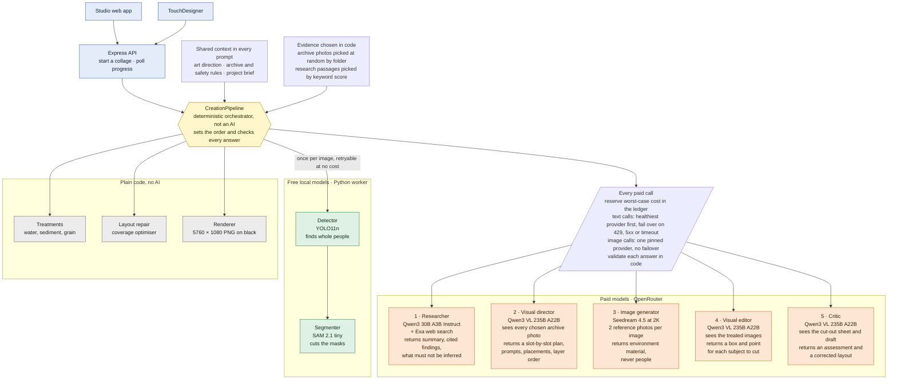

# How Kuchema makes a collage

The studio is not a free-running multi-agent system. One deterministic orchestrator, `CreationPipeline` in [server/pipeline.js](server/pipeline.js), calls five model roles in a fixed order and checks every answer in code before moving on. The paid models run through OpenRouter, under a per-collage cost ceiling ($5.00 by default, set by `CREATION_COST_LIMIT`). People detection and segmentation run locally at no cost.

This describes the working tree on 16 October 2026, including the provider failover in [server/routing.js](server/routing.js).

## 1. Who does what

- The models never call each other. Each one returns JSON or an image to the orchestrator, which validates it and builds the next model's input.
- Hard rules are enforced in code, not left to the models. People only come from archive photos and are never transformed. Generated images exclude people. Each layer stays at or under 58% of the canvas. Permissions are checked against every layer.
- The three Qwen3 VL roles are the same model with different instructions and inputs.

## 2. One collage, end to end

```mermaid
flowchart TB
  classDef paid fill:#fde7d4,stroke:#c2652a,color:#3b1d08
  classDef local fill:#dff1e4,stroke:#2f7d4a,color:#0f2e1a
  classDef stop fill:#fbe3e3,stroke:#b42318,color:#4a0d0d
  classDef io fill:#e3ecf8,stroke:#3a64a8,color:#0e1f3d

  subgraph S0["At server start"]
    direction LR
    B1["Import archive/ photos<br/>folder sets the role: people, general,<br/>water, collage style guide"] --> B2["Index research text<br/>training-data/scripts and papers"] --> B3["Load art direction<br/>training-data/system_prompt.txt"]
  end

  T(["Studio app or TouchDesigner<br/>POST /api/creations<br/>prompt, 6–20 images, options"]):::io
  S0 ~~~ T

  subgraph S1["1 · Preflight, nothing spent"]
    direction TB
    C1["Checks: API key, local models installed,<br/>one collage at a time"]
    C2["Pick archive photos at random<br/>2–8 people photos to crop (leaving 3 generated)<br/>2+2 general and water references, 3+3 above 12 images<br/>1 style-guide collage for composition only"]
    C3["Generated images = total minus people photos"]
    C4["Pick 3–6 research passages by keyword score<br/>one per file; at least 2 lead a generated slot<br/>every passage states a relationship"]
    C5["Live price check on OpenRouter<br/>up to 3 providers per role within budget"]
    C6{"Worst case over the cost cap?<br/>($5.00 by default)"}
    C1 --> C2 --> C3 --> C4 --> C5 --> C6
  end
  T --> C1
  C6 -- yes --> X1["Stop, nothing charged"]:::stop

  subgraph S2["2 · Research and plan"]
    direction TB
    R1["Context search<br/>Qwen3 30B A3B Instruct + Exa web search"]:::paid
    R2{"Verifiable cited sources?"}
    P1["Advance collage plan<br/>Qwen3 VL 235B A22B<br/>sees every chosen archive photo"]:::paid
    P2["Validate the plan in code<br/>exact slots and permissions, no generated people,<br/>every generated image treated, at most 3 treatment types,<br/>a layout consequence for every paper"]
    R1 --> R2
    R2 -- yes --> P1 --> P2
  end
  C6 -- no --> R1
  R2 -- no --> X2["Stop"]:::stop

  subgraph S3["3 · Make the material, slot by slot"]
    direction TB
    M1{"Slot type"}
    M2["Use the archive people photo unchanged"]
    M3["Generate a speculative environment image<br/>Seedream 4.5 · 2K · 1 general + 1 water reference<br/>2 at a time"]:::paid
    M1 -- "archive people" --> M2
    M1 -- "generated" --> M3
  end
  P2 --> M1

  subgraph S4["4 · Cut out the parts"]
    direction TB
    G1["Grounding on untreated images<br/>Qwen3 VL 235B A22B<br/>one box and point per fragment:<br/>a primary cut per image, detail cuts from generated images"]:::paid
    G2["Detect people<br/>YOLO11n"]:::local
    G3["Segment<br/>SAM 2.1 tiny<br/>field, silhouette or residue edge"]:::local
    G4{"Clean, selective cut?"}
    G5["Save as a failed part<br/>retry later without paid calls"]
    G6["Treat the whole image once in code,<br/>crop each cut with its SAM box and alpha,<br/>then an optional torn-paper edge (never people)"]
    G1 -- "for each image" --> G2 --> G3 --> G4
    G4 -- no --> G5
    G4 -- yes --> G6
  end
  M2 -- "all slots ready" --> G1
  M3 -- "all slots ready" --> G1

  subgraph S5["5 · Compose and review"]
    direction TB
    K1["Assemble from the plan's placements<br/>environment fields behind, people in front"]
    K2["Layout repair in code<br/>fill the canvas, at most 58% per layer,<br/>at least 25% of each fragment visible"]
    K3["Render draft"]
    K4["Collage critique<br/>Qwen3 VL 235B A22B<br/>sees the cut-out sheet and draft"]:::paid
    K5{"Revise?"}
    K6["Rebuild the layout and repair again"]
    K7["Render final 5760 × 1080 PNG on black<br/>check permissions, save the cost ledger"]
    K1 --> K2 --> K3 --> K4 --> K5
    K5 -- yes --> K6 --> K7
    K5 -- no --> K7
  end
  G6 --> K1
  G5 -. "study continues without it" .-> K1

  OUT(["Poll GET /api/creations/id<br/>collage PNG, warnings, provenance JSON"]):::io
  K7 --> OUT

  subgraph KEY["Key"]
    direction LR
    L1["Paid model call"]:::paid
    L2["Free local model"]:::local
    L3["Plain code"]
  end
```

## Models at a glance

| Step | Role | Model | Runs | Calls per collage | Sees images |
|---|---|---|---|---|---|
| Context search | Researcher | `qwen/qwen3-30b-a3b-instruct-2507` + Exa web search | OpenRouter, paid | 1 | No |
| Advance collage plan | Visual director | `qwen/qwen3-vl-235b-a22b-instruct` | OpenRouter, paid | 1 | Every chosen archive photo |
| Generate | Image generator | `bytedance-seed/seedream-4.5` | OpenRouter, paid | 1 per generated image | 2 reference photos |
| Transformed image grounding | Visual editor | `qwen/qwen3-vl-235b-a22b-instruct` | OpenRouter, paid | 1 | Every working image |
| Collage critique | Critic | `qwen/qwen3-vl-235b-a22b-instruct` | OpenRouter, paid | 1 | Cut-out sheet and draft |
| Detect people | Detector | YOLO11n (`models/yolo11n.pt`) | Local CPU | 1 per image | Yes |
| Segment | Segmenter | SAM 2.1 tiny (`models/sam2.1_t.pt`) | Local CPU | 1 or more per image | Yes |

`openai/gpt-image-2.5-sunburst` can be selected as a premium image model. The price check blocks it because it has no fixed per-image price, so its worst case cannot be bounded under the cost cap.

With the default of 10 images, 4 are archive people cut-outs and 6 are generated. That makes 10 paid calls: 4 text calls and 6 image calls. If a text provider fails, the call is retried with the next provider, and every attempt reserves its own worst-case cost. Image generation uses one pinned provider, so an image call that fails stops the collage.

Model IDs are in [server/budget.js](server/budget.js). The local worker is [scripts/vision-worker.py](scripts/vision-worker.py).
