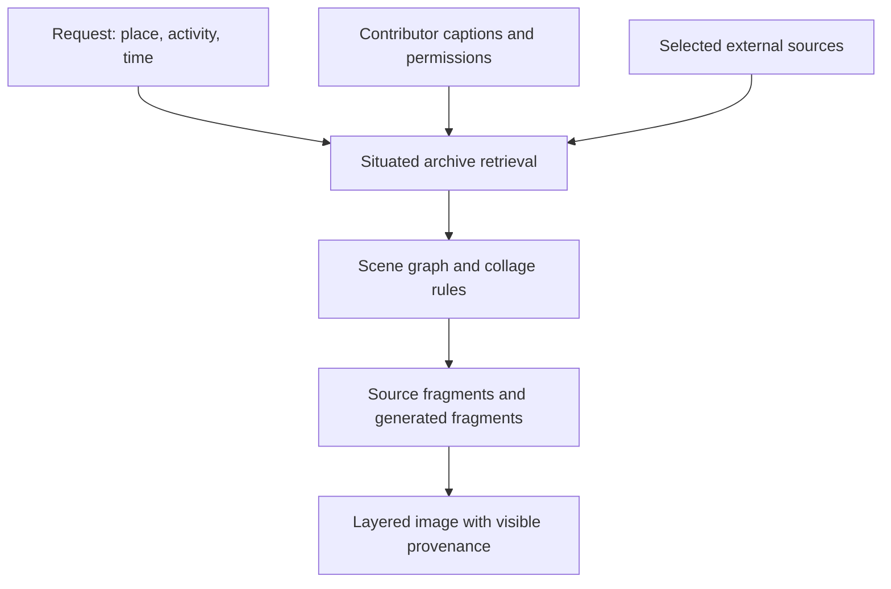

I think collage gives you a much richer direction than fine-tuning. Fine-tuning asks, “How can this model represent Lebanon or Zimbabwe more accurately?” Collage lets you ask, “Who constructs an image of a place, from which materials, and what remains incompatible or missing?”

The research supports your starting observation. Text-to-image systems often default toward US/Western visual environments, while geographical prompts can replace that default with narrow national stereotypes. A 27-country study found substantial differences in whether people felt generated everyday objects resembled their surroundings. Community research in Pakistan, India and Bangladesh describes the outputs as reproducing an outsider’s gaze rather than simply making occasional factual errors. [Basu et al.](https://kiac.iisc.ac.in/wp-content/uploads/2025/06/Abhipsa-Basu.pdf), [Qadri et al.](https://arxiv.org/abs/2305.11844), [AI’s Blind Spots](https://arxiv.org/html/2506.16898v2)

## A stronger conceptual model

I would describe the project as a situated collage system rather than a geographically corrected image generator.

The archive would not teach the model what “Lebanon” looks like. It would provide partial, attributed accounts of particular places:

- This street, photographed by this person, in this season.
- This plant is used in this way by this community.
- This water source has this history, sound and social function.
- This contributor permits cropping but not synthetic alteration.
- No suitable material exists for another part of the request.

That last possibility matters. The system should sometimes leave a space empty, retain an unresolved seam or say that its archive cannot support a depiction. Otherwise, it merely converts limited local material into a new claim of completeness.

I would also avoid making the country the main unit. “A Lebanese village” still compresses significant differences between Akkar, the Bekaa, the South, Mount Lebanon and other places. Retrieval could begin with locality, season, ecology, materials, activity, historical period and the contributor’s relationship to the place.

## A possible system



The LLM should not simply search the internet and write a longer prompt. Search engines contain many of the same representational imbalances as image-training datasets. Instead, the LLM could produce an evidence packet:

1. What the archive supports.
2. What comes from external research.
3. What remains uncertain.
4. Which references may influence each part of the image.
5. What the system must not infer.

It would then produce a structured scene plan rather than one prose prompt:

```json
{
  "region": "specific locality",
  "time": "late summer, recent past",
  "layers": [
    {
      "role": "ground",
      "references": ["image_028", "image_117"],
      "transform": ["crop", "recolour"],
      "source_type": "community archive"
    },
    {
      "role": "water",
      "references": ["video_014"],
      "transform": ["extract_frames", "segment"],
      "source_type": "workshop documentation"
    }
  ],
  "unsupported_elements": ["interior domestic objects"]
}
```

This structure gives you control and makes the final image traceable.

## How your contributed images can be used

There are several levels, from least to most transformative:

| Method                    | What it does                                                         | Limitation                                                       |
| ------------------------- | -------------------------------------------------------------------- | ---------------------------------------------------------------- |
| Retrieval                 | Finds relevant images using captions, metadata and visual embeddings | Does not directly control generation                             |
| Direct collage            | Cuts source material into the final image                            | Most faithful, but visibly composite                             |
| Reference conditioning    | Feeds selected images into the generator during inference            | May reduce culture to colour, texture or style                   |
| Image-to-image/inpainting | Regenerates around existing fragments                                | Can overwrite important local details                            |
| LoRA/fine-tuning          | Changes the model’s learned tendencies                               | Risks turning a situated archive into another generalized “look” |

For retrieval, combine contributor-written metadata with visual embeddings such as SigLIP or CLIP. Contributor captions should take priority over automatic descriptions. Useful fields might include location, date, season, materials, activity, ecology, photographer, relationship to the location, permissions and prohibited transformations.

For generation without training, **IP-Adapter** can condition a diffusion model using one or more reference images while retaining a separate text prompt. It is lightweight because the base generator remains frozen. However, its visual encoder does not necessarily understand why an architectural detail, object or gesture matters locally; it primarily transfers visual information. [IP-Adapter](https://ip-adapter.github.io/)

Consequently, I would mix reference-conditioned generation with literal source fragments. A wall might be generated from two architectural references, while a water container or plant is taken directly from a contributed photograph. The distinction could remain visible.

## Cropping and collaging through code

A practical scripted process could be:

1. Retrieve perhaps 12 relevant photographs and video moments.
2. Generate a contact sheet that the artist or participant can amend.
3. Use **SAM 2** to isolate chosen objects, bodies, vegetation, water or architectural components.
4. Construct a large layered canvas with masks, positions, scale, rotation and depth order.
5. Generate missing regions separately.
6. Composite the layers.
7. Optionally repair only the borders with inpainting.
8. Export the image, its editable layer file and a provenance map.

SAM 2 works with images and video and can track a selected object across frames, making it particularly useful for extracting moving fragments. [SAM 2](https://ai.meta.com/research/sam2/)

There are three possible treatments of the seams:

- **Hard cut:** Preserve irregular masks, changes in resolution and conflicting perspectives.
- **Soft collage:** Feather edges and match approximate colour and brightness.
- **Synthetic unification:** Use inpainting or harmonisation to reconstruct transitions.

I would begin with hard or partially visible seams. Fully harmonising the image can erase the very differences your method introduces.

If you independently generate every fragment and then combine them, perspective, scale and lighting will rarely match. This may be aesthetically productive. If you want greater coherence, first establish a shared depth map, horizon and rough spatial layout. Then generate each area using overlapping masks and common structural conditioning. **ControlNet** can retain edges, depth, poses or segmentation layouts, while **MultiDiffusion** demonstrates how separate diffusion processes can be assigned to regions and combined without fine-tuning. [ControlNet](https://arxiv.org/abs/2302.05543), [MultiDiffusion](https://proceedings.mlr.press/v202/bar-tal23a.html)

In other words, you could define:

- Polygon A: vegetation references from one contributor.
- Polygon B: architecture references from another.
- Polygon C: water derived from a workshop video.
- Polygon D: deliberately unsupported and left blank.

That is much more controllable than generating complete images and hoping their crops happen to work together.

## Using video

Video could become more than a supply of still photographs:

- Extract varied keyframes rather than evenly spaced frames.
- Track an object with SAM 2 and cut it out at several moments.
- Use successive temporal fragments of the same object in one still image.
- Convert movement into collage rules: direction, repetition, erosion, expansion or rhythm.
- Make an animated collage in which fragments retain their original temporalities.
- Retrieve moments using spoken narration, transcripts, sound and movement as well as visual similarity.

For example, water from six successive frames could cross the image while the surrounding architecture remains still. A body could appear through several overlapping positions. This would resist the generator’s tendency to freeze geography into a picturesque landscape.

## Artistic directions that could make the project distinctive

The strongest version may allow workshop participants to author the rules rather than merely donate images. Children might decide:

- Which things may touch.
- Which elements should be enlarged.
- What belongs underground or outside the frame.
- Which material must remain unaltered.
- Whether two fragments may ever be shown together.
- What the machine should do when it does not know.

Their collage becomes a computational grammar. The AI performs or misperforms these instructions, and participants can revise them.

Other possible forms include:

- **A plural image:** Different contributors control separate regions, with no system authorised to reconcile them.
- **The refusal image:** Missing archival evidence appears as blanks, redactions or written uncertainty.
- **The provenance image:** Selecting a fragment reveals its contributor, history and permitted use.
- **The comparison:** The ungrounded model output, retrieved archive and constructed collage appear together.
- **A changing archive:** The image is regenerated whenever contributors add, remove or recaption material.

## Relevant precedents

Your exact combination still seems fairly unusual, but several projects and studies provide close conceptual precedents:

- Rida Qadri and colleagues asked South Asian participants to co-design prompts and evaluate image outputs, treating community members as experts rather than generic annotators. This is especially relevant to how you might structure workshops. [Qadri et al.](https://arxiv.org/abs/2305.11844)
- Caroline Sinders’ **Feminist Data Set** treats collecting, labelling, deciding and building the interface as parts of the artwork—not merely preparation for a model. [Feminist Data Set](https://carolinesinders.com/feminist-data-set/)
- Stephanie Dinkins’ **Not the Only One** creates an AI from multigenerational Black family oral histories. It offers a precedent for an archive remaining relational and attributed rather than becoming anonymous training material. [Not the Only One](https://www.stephaniedinkins.com/ntoo.html)
- Anna Ridler’s practice foregrounds handmade datasets, classification and the labour behind machine-generated images. **Mosaic Virus**, for example, emerges from her own tulip dataset rather than an invisible mass archive. [Mosaic Virus](https://annaridler.com/works/mosaic-2019)
- Recent geographic evaluation research is moving toward cultural descriptors, participant judgement and diversity measures rather than asking only whether an image matches its prompt. [Towards Geographic Inclusion](https://arxiv.org/html/2405.04457v1), [CULTIVate](https://arxiv.org/abs/2511.05681)

My recommendation would be to prototype the direct-collage version first: a small, consented archive; contributor-authored metadata; retrieval; SAM-based cutting; rule-based placement; and only narrow uses of generation. Once that works, you can experimentally introduce reference-conditioned generation and observe exactly where the pretrained model begins replacing situated information with its existing visual expectations. That replacement could itself become part of the artwork.

The transformations should do more than make the collage attractive: they can show how an image has been translated, damaged, remembered or displaced. I would combine transformations at three stages.

### Before cropping: transform the source itself

These change what the crop contains and how its boundaries behave.

- **Print, damage and rescan:** Crumple, fold, tear, wet, scratch or expose the print to sunlight before scanning it again.
- **Material transfer:** Print onto fabric, tracing paper, acetate, newspaper, wood or handmade paper.
- **Repeated reproduction:** Print, photograph, compress and print again. Each generation loses different information.
- **Projection:** Project the image onto soil, water, plants, buildings or bodies, then photograph the projection.
- **Perspective distortion:** Stretch or warp the source according to terrain, topography or the direction of water.
- **Selective erasure:** Remove faces, skies, buildings or colonial markers before the cropping algorithm sees the image.
- **Colour separation:** Split RGB or CMYK channels, move them independently, then crop the displaced result.
- **Thresholding and posterisation:** Reduce the photograph to a small number of tones, allowing shapes to become graphic.
- **Temporal accumulation:** Combine several video frames before cropping so movement appears as repetition or residue.
- **Scale disruption:** Enlarge a tiny material detail—soil, stone, cloth, a leaf—until it becomes a landscape.

### Transform the crop boundary

The shape of the crop can carry meaning. I would avoid relying mainly on clean rectangles or perfectly segmented objects.

- Crop according to rivers, roads, property boundaries or elevation lines.
- Use children’s hand-drawn shapes as masks.
- Cut according to shadows rather than objects.
- Let one contributor’s gesture—drawing, tearing or touching—define the boundary.
- Make the mask respond to sound intensity from the location.
- Use vegetation or water movement from video to create changing edges.
- Introduce incomplete segmentation so parts of the surroundings remain attached.
- Crop negative space rather than the subject.
- Use the same mask at several scales across different images.
- Make permissions determine the boundary: parts not authorised for alteration remain outside the crop.

This stops segmentation from pretending that an object is separable from its environment.

### After cropping: change how fragments relate

- **Scale inversion:** Make a water container larger than a building or a plant larger than the settlement.
- **Repetition:** Repeat one crop with slight differences in time, colour or position.
- **Misregistration:** Offset colour channels or duplicate masks by a few pixels.
- **Occlusion:** Allow culturally significant elements to remain partly hidden rather than presented as illustrative evidence.
- **Conflicting perspectives:** Combine aerial, eye-level and ground-level views without correcting them.
- **Unequal resolution:** Keep some fragments sharp and others pixelated, acknowledging unequal image availability.
- **Shadow invention:** Give a fragment a shadow belonging to another object or time of day.
- **Texture exchange:** Transfer the texture of soil onto a building, or water onto clothing, without changing the underlying shape.
- **Edge residue:** Retain halos, source backgrounds and fragments caught by imperfect masks.
- **Partial harmonisation:** Match colour in some regions while leaving other fragments visibly separate.
- **Local inpainting:** Regenerate only narrow spaces between fragments, rather than smoothing the whole collage.
- **Text intrusion:** Allow captions, coordinates, oral testimony or uncertain model descriptions to enter the image itself.

## More distinctive compositional systems

Rather than applying random effects, you could establish a transformation grammar.

For example:

| Source relationship                    | Transformation                                       |
| -------------------------------------- | ---------------------------------------------------- |
| Photographed by someone from the place | Remains recognisable and minimally altered           |
| Found through internet search          | Heavily compressed, blurred or reduced to texture    |
| Generated by AI                        | Given an artificial edge, repeated or visibly marked |
| Historically uncertain                 | Partially erased                                     |
| Drawn by a child                       | Controls scale or crop boundary                      |
| Extracted from video                   | Appears several times across the image               |
| Restricted by contributor              | Shown only through absence, outline or covered area  |

This gives the visual treatment an internal logic.

## Five strong experiments

1. **Water as the cutting agent**
   Use water movement from workshop videos to generate animated masks. The water decides which parts of photographs become visible.

2. **The landscape made from details**
   Construct an entire landscape from extreme crops of walls, fabric, skin, soil, plants and containers. No original horizon is retained.

3. **Refused perspective**
   Keep every fragment in its original perspective and scale relationship. Do not make them agree spatially.

4. **Archive versus generator**
   Generate an image, then progressively replace its regions with crops from the contributed archive. Keep traces of the generated image visible beneath.

5. **Collective transformation chain**
   One person chooses an image, another transforms it, a child draws the crop, the algorithm places it, and another participant decides what must be removed.

The most compelling approach for this project may be to make different kinds of images undergo different transformations. If every crop receives the same visual filter, the result can look like a design style. If transformations follow provenance, permission, uncertainty and relationships to place, the collage begins to have its own artistic argument.
