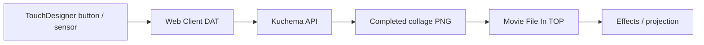

# TouchDesigner integration

Keep Kuchema running as the image generator and use TouchDesigner for display, animation and interaction. The existing HTTP API supports triggering a collage, checking its progress and retrieving its images.

These instructions assume both applications run on the same computer. The snippets are intended for TouchDesigner's Python environment; a ready-made `.toe` or `.tox` component is not included.



## 1. Start Kuchema

Run this from the repository directory:

```sh
npm run dev
```

Keep the server running. TouchDesigner can connect to `http://127.0.0.1:3000`.

The official photographs must be available locally in `archive/`, and the local cutting models must be installed. Keep `OPENROUTER_API_KEY` in the server's `.env`; TouchDesigner does not need the provider key. See the [README](README.md) for installation instructions.

## 2. Trigger a collage

Create a **Web Client DAT** named `kuchema_api`. It supports HTTP requests and response callbacks. See the [Web Client DAT Python documentation](https://derivative.ca/UserGuide/WebclientDAT_Class).

Run this from a Text DAT or button callback in the same component as `kuchema_api`:

```python
import json
import uuid

op('kuchema_api').request(
    'http://127.0.0.1:3000/api/creations',
    'POST',
    header={'Content-Type': 'application/json'},
    data=json.dumps({
        'prompt': 'Water connects land, plants and collective life.',
        'count': 6,
        'researchCount': 4,  # 2–10 local research files
        'researchIds': [],  # Empty selects from the whole research archive
        'includePeople': True,
        'enabledTransforms': ['water-flow', 'sediment-wash', 'print-grain'],
        'requestId': str(uuid.uuid4())
    })
)
```

Research files guide at least two generated fragments and the composition. `researchCount` defaults to 4; `researchIds` optionally restricts the eligible pool using IDs returned by `/api/studio`. The job retains `researchDocuments`, `researchAssignments` and `researchCoverage` for attribution.

This uses the official archive and its random category-selection rules. `count` can be 6–20 and defaults to 10. People come from direct archive cutouts; generated components contain environmental material. `enabledTransforms` lists permitted treatments, not effects that must all be used. Pass `[]` to disable all treatments. Omit it to use the gentle server defaults. Browser checkbox preferences are local to the browser, so send your preferred list explicitly from TouchDesigner.

In the Web Client DAT's response callback, parse the response body with `json.loads(data)` and retain the returned job's `id`. A successful submission returns HTTP `202`. Handle non-success responses by displaying their `error` field.

Use a new `requestId` for each new collage. If retrying the same submission after a connection problem, reuse its original `requestId` to avoid starting another job.

## 3. Poll for completion

Create another **Web Client DAT**, for example `kuchema_status`. Use a timer to make a request every two seconds while the job is running:

```python
# job_id is the id retained from the creation response.
op('kuchema_status').request(
    'http://127.0.0.1:3000/api/creations/' + job_id,
    'GET'
)
```

Avoid overlapping requests if the previous status request is still in progress. Parse the response JSON in this DAT's callback.

| Response field | Use in TouchDesigner |
| --- | --- |
| `id` | Identify the current job |
| `stage`, `progress` | Display generation progress |
| `status` | Detect completion, cancellation or failure |
| `outputUrl` | Retrieve the completed image when available |
| `warnings` | Identify incomplete cuts or composition issues |
| `error` | Explain a failed job |

Stop polling when the job is complete, failed, cancelled or interrupted. Only load a result when `status` is `complete` **and** `outputUrl` is present. A completed study may be partial or waiting for local cutting retries, so inspect its warnings.

Keep the previous collage visible while another is being generated. The server accepts one generation at a time; disable new generation triggers while a job is active.

## 4. Load the finished image

Create a **Movie File In TOP** named `collage`. In the status-response callback, use the parsed job response to load the image:

```python
import json

# data is the response body supplied to the Web Client DAT callback.
job = json.loads(data)

if job.get('status') == 'complete' and job.get('outputUrl'):
    op('collage').par.file = (
        'http://127.0.0.1:3000' + job['outputUrl']
    )
```

This snippet is callback-body code, not a complete callback definition. Use the callback template supplied by your TouchDesigner version, and keep `collage` in the same component or adjust its operator path.

Movie File In TOP supports loading images through HTTP. See the [Movie File In TOP documentation](https://docs.derivative.ca/Movie_File_In_TOP).

The generated collage is a 2400 × 1500 PNG. Connect the TOP to your effects and projection network. For smooth transitions, keep the previous image in a second TOP and crossfade after the new image has loaded.

## 5. Animate individual fragments

For independent movement of people, water and other material, use the separate cutouts instead of the flattened collage.

The job response contains `project.layers`. Each layer includes its `assetId`, position, dimensions, rotation, opacity and visibility. Its image is available at:

```text
http://127.0.0.1:3000/media/<assetId>.png
```

Load each cutout into its own Movie File In TOP and use the saved layout as its starting arrangement. The automatic cutouts preserve transparency, allowing TouchDesigner to animate the original people cutouts and generated environmental material independently.

Layout coordinates use a 1600 × 1000 canvas with the origin at the top left. Preserve layer order and account for TouchDesigner's coordinate and pivot conventions when translating the positions and rotations. The final flattened PNG is rendered at 1.5 times that working resolution.

## API reference

| Method | Endpoint | Purpose |
| --- | --- | --- |
| `GET` | `/api/health` | Check that the server responds |
| `POST` | `/api/creations` | Start a collage |
| `GET` | `/api/creations/<job-id>` | Read progress and results |
| `POST` | `/api/creations/<job-id>/cancel` | Request cancellation |
| `GET` | `/media/<image-id>.png` | Load an output or cutout image |

All examples use the default port, `3000`. If you change `PORT` in `.env`, update the URLs in TouchDesigner too.
